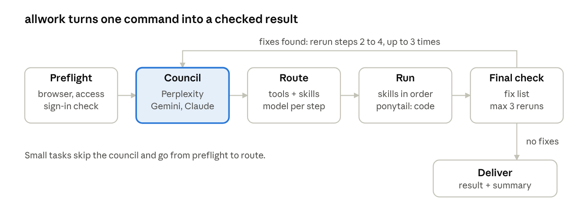

# allwork

One command, `allwork`, that takes any task to a checked result. It reviews the task in Claude, Perplexity and Gemini in your own browser, picks the tools, skills and Claude model for each step, runs the route, then checks the output and reruns fixes up to three times.



## What it does

- **Council review you can watch.** Perplexity and Gemini are operated in your browser through Claude in Chrome (Chrome or Brave), and the summary shows a screenshot, the exact question and a one-line answer for each.
- **Finds the best tools for you.** After the council, it asks Perplexity and Gemini which AI tools on the internet are best for each part of the task, checks the official pages, ranks them on fit, quality, cost, privacy and speed, and picks one plus a backup. You never have to name a tool.
- **Routing by task type.** Images and design, notes and documents, research, app and web dev, video and audio each start from a default list of tools, which discovery can replace.
- **A Claude model per step.** The lightest model that does the step well.
- **A capped final check.** Fixes found are rerun with a fix list, at most 3 times, then handed back to you.
- **Safety rules.** Private data stays on local models, and anything that publishes, sends, deploys or deletes waits for your yes.

## Requirements

- A Claude plan with skills enabled. Skills work on Free, Pro, Max, Team and Enterprise; code execution must be on.
- For the council: the Claude in Chrome extension, and signed-in Perplexity and Gemini accounts in that browser.
- The [ponytail](https://github.com/DietrichGebert/ponytail) skill (MIT). Rule 9 makes it mandatory for any coding step.

## Install

### Claude.ai (zip upload)

1. Zip the skill folder so the zip contains one folder named `allwork` with `SKILL.md` inside:
   ```
   cd .claude/skills
   zip -r allwork.zip allwork
   ```
2. In Claude, go to **Customize > Skills**, click **+**, choose **Create skill**, then **Upload a skill**, and pick `allwork.zip`.
3. Turn the skill on.

### Claude Code (personal skill)

```
mkdir -p ~/.claude/skills
cp -r .claude/skills/allwork ~/.claude/skills/
```

### Claude Code (project skill)

Clone this repo and start Claude Code from its root. The skill is picked up from `.claude/skills/allwork/`.

## Use

```
allwork <your task>
allwork full <your task>      # always run the full council
```

## How it works

Start with [docs/how-it-works.md](docs/how-it-works.md). It walks through every step with a diagram.

| Diagram | What it shows |
| --- | --- |
| [Overview](docs/diagrams/01-overview.png) | the five steps and the loop |
| [A run](docs/diagrams/02-how-a-run-goes.png) | private, small and complex tasks |
| [Preflight](docs/diagrams/03-step-0-preflight.png) | how it finds a browser you can watch |
| [Council](docs/diagrams/04-council.png) | Perplexity, Gemini and Claude, and how the result picks tools |
| [Tool pool](docs/diagrams/05-tool-pool.png) | tools by task type |
| [Final check](docs/diagrams/06-final-check-loop.png) | the 3-loop cap |

## Make it yours

The tool lists in the skill are starting points for one person's setup. Rule 2 asks you to name your own skills so they take priority, and the starter table lists apps that person had connected. Replace them with your own. Rule 9 expects the ponytail skill; remove it from the rules if you do not use it.

## Status

Tested end to end on five real runs: a research task, a repo-packaging task, a reel script, a reel video, and a no-tool-named run that found, chose and used its own tools and reran a failed check. Still not exercised: the 3-loop halt, the approval pause before publishing, private-data local routing, per-step model switching, and the newest rules (write access, public release). Treat it as a working draft.

## License

MIT. See [LICENSE](LICENSE).
