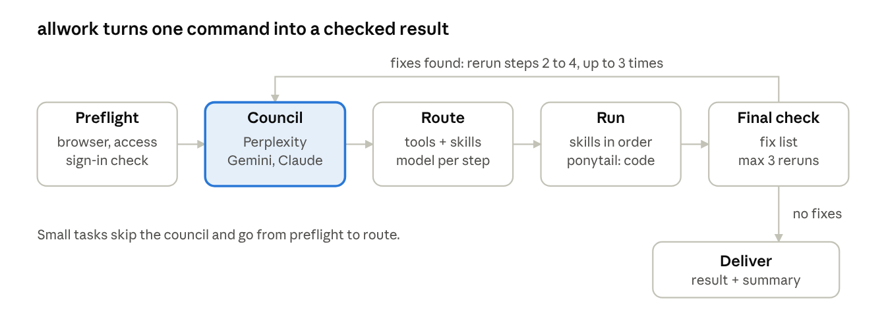
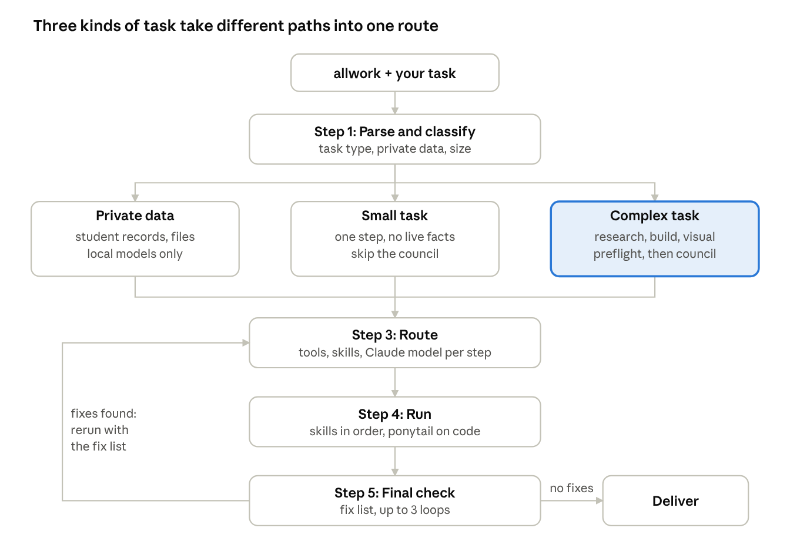
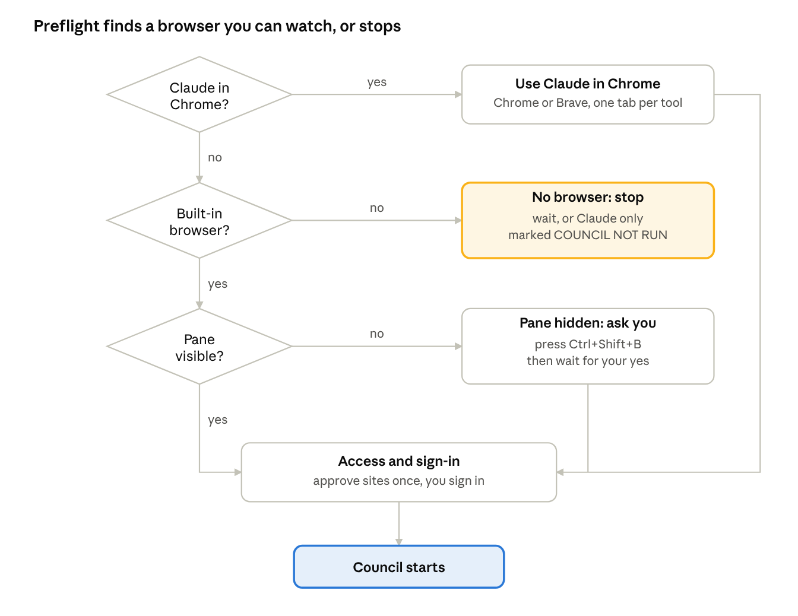
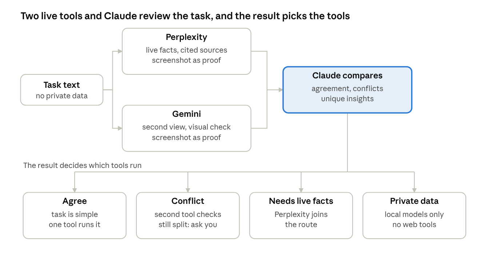
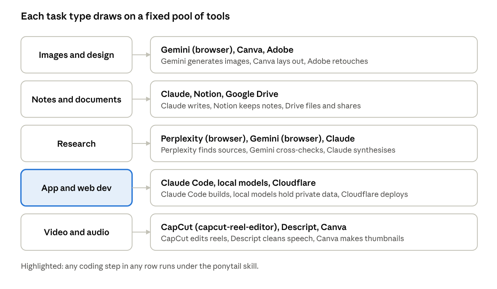
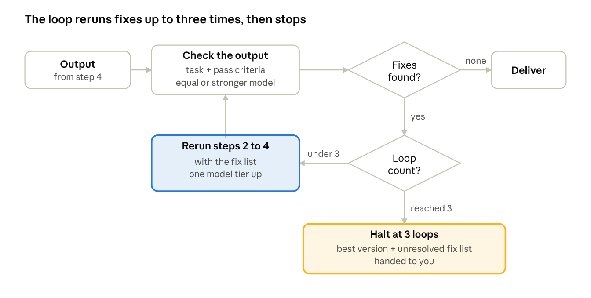

# How allwork works

`allwork` turns one command into a checked result. Every run goes through the same steps, and every step has a rule that stops it going quiet.

## Overview

One command takes any task to a checked result. It reviews the task in Claude, Perplexity and Gemini in your browser, picks tools, skills and a Claude model per step, runs the route, then checks the output and reruns fixes up to three times.

Small tasks skip the council. Anything that publishes, sends or deletes waits for your approval, and any coding step runs under the `ponytail` skill.

## How a run goes

Step 1 sorts every task onto one of three paths, and all three meet at the same route and the same final check.

Private data stays on local models. Small tasks skip the council. Complex tasks run preflight and the council first. A failed final check reruns the work with a fix list, up to three times, and anything still unresolved is handed to you.

## Step 0: tool preflight

Before any council step, allwork picks a browser you can watch, or stops and says why. Gemini and Perplexity are websites, so Claude operates them in a browser and never through screen control.

Claude in Chrome comes first and works in Chrome or Brave. The built-in browser is the fallback, and its pane must be visible or you cannot watch. Claude asks you to approve gemini.google.com and perplexity.ai once, and you sign in yourself. Claude never enters credentials.

## The council

On complex tasks Claude sends the same task text to Perplexity and Gemini in your browser, reads both answers, and compares them before choosing tools. Claude never writes or guesses either answer.

For each tool the summary must hold a screenshot of the finished answer, the exact question sent and a one-line answer summary. A missing screenshot is retaken. If it still cannot be captured, the summary says `PROOF MISSING` and the run is not marked PASSED.

## Tools and models

allwork picks tools from a fixed pool by task type, and a tool goes into a route only if it is actually connected in the session.

Each step also gets the lightest Claude model that can do it well.

| Model | Use it for |
| --- | --- |
| Haiku | simple, fast or bulk work: renaming, formatting, short summaries |
| Sonnet (default) | everyday work: notes, research synthesis, standard coding, writing |
| Opus | hard reasoning, multi-step builds, tricky debugging, long or high-stakes documents |
| Fable | the hardest tasks, only if the account has it |

Private-data tasks use local models whatever the tier. A rerun in the final-check loop moves up one tier.

## Final check and the loop

Before you see anything, allwork checks the output against your task and the pass criteria for its type, on a model at least as strong as the one that made it.

A rerun repeats steps 2 to 4 with the fix list; step 2 is skipped for small tasks. A run that used the council must also hold proof for both Gemini and Perplexity, plus the Council Status and Shown On Screen lines. A missing item goes on the fix list.

| Task type | Must hold |
| --- | --- |
| Notes and documents | facts match their sources; format and length as asked; house rules followed |
| Research | every claim has a source that was opened; dates current; conflicts flagged; unconfirmed items stated |
| App and web dev | runs without errors; does what was asked; actually tested; nothing deployed without approval; ponytail active and the change is the smallest that solves the task |
| Images and design | matches the brief; text readable and spelled right; size and format right; brand palette used; judged by looking |
| Video and audio | length, resolution and export as requested; audio in sync; no repeated footage; file location reported |

## Finding the best tools

After the council, allwork asks Perplexity and Gemini which AI tools on the internet are best for each part of the task. It combines their lists with what is already connected in your session, opens the official page of each shortlisted tool, and ranks them on fit, quality, cost, privacy, speed and sign-in. It picks one tool and one backup per sub-task. The diagram above shows the starter table, not a limit. It never creates accounts, enters passwords or pays without your yes.

## The twelve rules

| # | Rule | What it means |
| --- | --- | --- |
| 1 | Private data hard rule | Private records and confidential local files never go to Gemini or Perplexity; local models only |
| 2 | Skill priority | Your own skills beat built-in ones when both apply |
| 3 | Human approval | Publishing, sending, deploying, editing live sites or deleting waits for your yes, and the route is shown first |
| 4 | Loop cap | The final-check loop runs at most 3 times, then halts with an unresolved fix list |
| 5 | Model selection | The lightest Claude model that does each step well; a rerun moves up one tier |
| 6 | Never fake the council | Gemini and Perplexity answers come from operating them; a tool that did not run is reported as not run |
| 7 | Only use what is connected | A tool is routed only if it is available in the session |
| 8 | Show the work, with proof | Screenshot, exact question and one-line summary for both tools, or `PROOF MISSING` and no PASSED |
| 9 | Ponytail is mandatory for code | Every coding step runs under the ponytail skill at full level, unless you say normal mode |
| 10 | Check write access first | Tools that write or publish are checked before routing; if denied, you get a ready package and manual steps |
| 11 | Check council answers against sources | Claims about your own product or an official tool are verified; unverified claims are left out |
| 12 | Public-release mode | Personal examples are removed and nothing is called pushed or live unless it was checked |

## What you get back

Every run ends with a summary in the chat: Council Status, Shown On Screen, Proof Per Tool, Agreement Points, Key Findings, Tools Used, Skills Activated, Models Used and a Quality Check Report.
